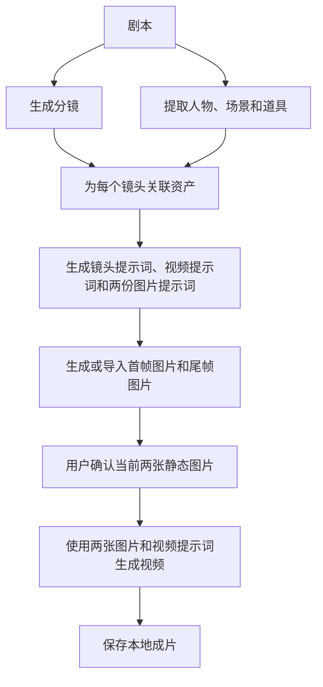

# DouBaoVideo 产品需求文档

**PRD 1.2  ｜  首版研发评审  ｜  2026 年 11 月 19 日**

DouBaoVideo 是一款 Windows 桌面视频制作工具。创作者先生成一周计划，再逐条在无限画布上制作剧本、分镜、镜头资产和首尾帧图片。确认两张图片后，软件使用已登录的豆包个人账号和可用的免费功能，按日生成并保存视频。

## 1 首版范围

| 模块 | 用户能完成的操作 |
| --- | --- |
| 周计划 | 按主题和风格生成 7 天任务及剧本草稿，设置每日数量和执行时间。 |
| 制作画布 | 编辑剧本、生成分镜、提取资产，给镜头连线并生成提示词。 |
| 图片确认 | 生成或上传两张静态图片，分别重做、替换和并排确认。 |
| 账号管理 | 同时保持多个豆包个人账号登录，按订阅档位筛选，查看免费可用状态。 |
| 任务与成片 | 定时或立即执行已准备好的任务，查看进度、恢复失败操作和保存本地视频。 |

### 首版默认规则

**制作粒度**　一条视频任务用一张画布、一张首帧图片和一张尾帧图片，交付一个视频文件。分镜用于组织这条视频的镜头。逐镜头独立出片与拼接、配音、烧录字幕和发布留作后续版本。

**拆解剧本**　DeepSeek-V4.1-Flash-1017 仅把已保存剧本拆成分镜候选。它不编写剧本、不提取资产、不写提示词，也不生图、出片或派发任务。软件校验分镜顺序和字段并展示候选，不自动覆盖已有分镜。

**费用与数据**　DeepSeek 拆解是独立的按量服务，默认关闭。用户配置并逐次确认后，只发送已保存的剧本正文及分镜格式要求，不附带资产、提示词、文件、账号会话或本地路径等额外数据。未配置或失败仍可手动分镜。其他步骤沿用原手动或已核实的豆包免费路径；遇到付费、费用不明或必要输入不受支持时暂停。

**节奏**　连续 7 天、每日计划 1 条为默认值。实际产量取决于素材确认进度和免费额度。

**极简交互**　每个视图突出一个主要操作，按制作进度提示下一步。画布自动布局，点节点才展开编辑区。资产关联可在镜头详情勾选，并同步为连线。筛选、指定账号、并发设置和历史记录按需展开。默认账号自动分配、全局并发为 1。具体布局及操作见 [界面操作设计文档](<./DouBaoVideo 界面操作设计文档.md>)。

## 2 周计划与制作入口

### PLAN 01 生成一周任务

新建周计划时填写主题、开始日期、每日执行时间和每日数量，选择「偏真人」或「漫剧」，可补充风格说明。日期与时间必须有效，每日数量为正整数。使用电脑本地时间，连续安排 7 个自然日。

**生成结果**　点击「生成一周任务」后，按日期创建任务和剧本草稿。同一创建操作重复点击时只产生一份计划。免费对话暂不可用时保留日期和任务，可在单条任务中补生成或粘贴剧本；创建计划本身不调用 DeepSeek。

**计划调整**　启用计划后开始按日调度。修改执行时间时更新尚未提交的计划任务，暂停时停止新的定时派发。对日期和数量的调整先显示会增减的任务，已经提交的记录保留在原任务下。

### PLAN 02 入口与各页面操作

| 页面 | 主要内容 | 主要操作 |
| --- | --- | --- |
| 周计划 | 日期、主题、风格、执行时间、每日任务进度 | 建计划、查看某日、打开画布、启用或暂停 |
| 制作画布 | 节点与连线、节点详情、当前制作进度 | 编辑、生成下一步、连线、预览及确认图片 |
| 账号管理 | 昵称、档位、登录和各项免费可用状态 | 添加、登录、刷新、筛选、启停、移除 |
| 任务队列 | 计划时间、执行状态、账号、异常原因 | 查看详情、立即执行、补跑、恢复异常 |
| 成片 | 本地预览、保存位置、版本与导出方式 | 打开文件或目录、重试下载、查看去水印选项 |

### 风格随任务传递

**偏真人**　以真人影视质感为目标，描述自然光影、服装、真实场景和摄影镜头。

**漫剧**　以漫画或动画质感为目标，描述角色造型、线条、色彩和画面表现。

任务默认继承周计划风格。剧本、分镜、资产、镜头提示词和两份图片提示词使用同一设定。提示词沿用固定的全片字段与逐镜头字段；相同模板的画面、运镜、声音和资产必须随镜头变化，未提供的时长或资产不编造。任务可单独调整风格，调整后把受影响的结果标为待更新。

## 3 无限画布与镜头资产

### CAN 01 画布操作

打开任务时定位到该任务的画布。支持平移、缩放、拖动节点和查看全局。点击节点查看内容、状态和可执行操作。节点位置、连线和内容自动保存，关闭或重启后可继续。移动节点位置只调整视图。

### CAN 02 按步骤制作

| 步骤 | 输入 | 结果与操作 |
| --- | --- | --- |
| 剧本 | 主题、风格、已有剧本 | 编辑剧本或用草稿。点击「生成分镜」。 |
| 分镜 | 当前剧本 | 按顺序创建镜头节点。编辑画面、动作、景别和运镜，支持调整镜头顺序。 |
| 提取资产 | 当前剧本及分镜 | 从剧本提取人物、场景和道具。可更新设定、合并重复项、添加资产和参考图。 |
| 给镜头连线 | 镜头节点和资产节点 | 拖线绑定或解除引用。可采用软件推荐的连线，再逐个镜头调整。 |
| 生成提示词 | 镜头顺序、画面、已连接资产及风格 | 生成各镜头提示词，再汇总为视频提示词。另存首帧提示词和尾帧提示词，文本可编辑。 |

### CAN 03 资产复用与变更

**引用关系**　一个镜头可连多个资产，一个资产可被多个镜头复用。节点被选中时，可以看到相关连线与镜头。比如「主角」连到镜头 1 和镜头 2，「雨伞」只连到镜头 2。各镜头提示词只取该镜头引用的资产设定。

**变更影响**　编辑剧本、镜头、资产或连线后，标出依赖该内容的下游节点。调整雨伞设定时，只将引用雨伞的镜头和相关汇总结果标为待更新。保留已编辑内容，用户可局部更新或核对后继续使用。

**整条视频**　首帧提示词描述开场画面，尾帧提示词描述结束画面，沿用角色、场景和风格。视频提示词按镜头顺序描述首尾之间的动作和画面变化。

## 4 首尾帧图片与确认

### IMG 01 分别制作两张静态图

首帧图片给视频提供开场参考，尾帧图片给视频提供结束参考。各自使用对应提示词生成静态图，也可从本地导入或替换。画布显示两张图片各自的生成状态、预览和所用提示词。

| 操作 | 条件和结果 |
| --- | --- |
| 生成首帧或尾帧 | 使用当前图片提示词及该步骤可用的免费生图账号。两张图片可分别生成、分别重试。 |
| 选择本地图片 | 校验文件是否为可读的静态图片。格式、尺寸及比例限制由目标入口实测后确定。校验失败时保留原图并显示原因。 |
| 预览与替换 | 并排预览当前两张图。重做其中一张时，另一张仍可预览。新结果由用户选作当前图片。 |
| 确认这两张图片 | 两张图齐备，且当前提示词及素材已完成检查时可确认。保存两张图片版本、视频提示词版本和确认时间。 |

### IMG 02 重新确认与提交时机

**等待确认**　两张图就绪后进入「待确认首尾帧」。到点仍待确认时提醒用户。确认发生在计划时间之后且计划仍启用时，可按当日任务规则入队。

**确认失效**　提交前替换任一张图，或改动会影响视频的风格、分镜、资产及提示词，旧确认失效。界面定位到待更新步骤，待当前素材重新确认后再派发。

**提交快照**　由 DouBaoVideo 把用户确认的资产及提示词交给豆包 AI 生成视频。提交读取同一次确认对应的首尾图和视频提示词；两张图分别放入各自的输入位。其他明确采用的关联资产仅在豆包入口支持时随请求提交；必要资产无法传入时提示并暂停，不静默忽略。手动立即执行与定时执行共用这项要求。已经提交的视频记录沿用当时的输入版本。

**视频参数**　任务详情展示横竖屏、目标时长和生成模式。选项取当前免费入口实测支持的值。如果原配置已不可用，标出需要调整的参数，等待用户确认。

**入口受限**　豆包免费入口无法接收两张图时，任务保留素材并显示「当前入口不支持首尾帧图片」。测通目标账号的免费入口后再启用这条自动提交路径。

## 5 账号管理与免费权益

### ACC 01 登录与会员档位

在账号管理中输入昵称并打开豆包官方登录页面，由用户完成登录及验证。每个账号有独立会话。重启后先恢复各自会话，过期时提示重新登录。移除账号清理本机会话，任务和成片仍可通过原记录查看。

| 记录项 | 展示规则 |
| --- | --- |
| 订阅档位 | 免费、标准、加强、高级。读取不到时显示「待确认」，支持手动标注和刷新，并注明来源。 |
| 订阅状态 | 按当前生效的订阅识别。试用状态和到期时间只在豆包页面提供时显示。 |
| 登录状态 | 已登录、待登录或需验证。另提供启用或停用切换。 |
| 免费生图与视频 | 分别显示可用、额度已用完或待核实。剩余次数和恢复时间按页面实际信息展示。 |
| 套餐专属额度 | 页面提供时展示在会员详情。任务使用当前可免费调用的功能。 |

列表可按订阅档位筛选。订阅购买页中当前选中的套餐标签只用于交易页面展示，账号档位读取该账号实际生效的方案。

### ACC 02 派发规则

**自动分配**　从已启用、已登录、当前步骤可免费执行的账号中选择。账号档位只作管理信息。全局并发可配置，同一账号同时最多执行一条生图或视频生成。

**指定账号**　等待指定账号可用，并明确显示登录、验证、额度或入口等等待原因。

**费用与限制**　免费生图和免费视频独立检查。出现付费提示、费用待核实或平台限制时暂停受影响的操作。没有符合条件的账号时保留任务，显示等待原因。

## 6 定时任务与异常恢复

### RUN 01 入队与补跑

以电脑本地时间触发。计划启用、到期、两张当前图片已确认且视频提示词齐全的任务进入队列。用户也可立即执行已准备好的任务。电脑开机、联网且软件在运行时可调度，最小化到托盘继续运行。

关机、休眠、退出或断网期间错过的任务恢复后标为「待补跑」，由用户选择补跑。在线到点时因首尾帧未确认而等待的任务，在确认后按已启用计划进入队列。暂停计划停止新的定时派发，已提交任务继续跟踪。

### RUN 02 状态与恢复操作

| 状态 | 到达条件或用户操作 |
| --- | --- |
| 制作中 | 画布素材或提示词仍在准备。打开画布继续。 |
| 待确认首尾帧 | 两张当前图片可以审核。用户确认或退回重做。 |
| 等待排期／待补跑 | 已确认，等待计划时间。漏跑任务由用户选择补跑。 |
| 排队中／等待可用账号 | 已到时间或手动触发，等待并发名额或账号条件满足。直接展示额度、登录或验证等原因。 |
| 提交中／生成中 | 提交当前版本的输入。收到可定位的远端结果后跟踪同一次生成。 |
| 待核实 | 提交结果不明，优先查询或检查原账号记录，由用户处理无法自动确认的结果。 |
| 待下载／下载失败 | 远端视频已生成。此时重试下载或导入，沿用同一次生成。 |
| 已完成／失败 | 本地文件可访问后标记完成。明确生成失败时显示原因并可发起重试。 |

### RUN 03 避免重复消耗

同一执行记录在定时触发、立即执行、重启或网络重试时最多向豆包提交一次。发送后结果不明时先核实，确认原请求失败后才允许重试。用户主动重做时创建新执行记录，保留前一次的输入、状态和成片。

## 7 成片管理与本地记录

### OUT 01 成片归档

下载或导入视频后验证本地文件可打开，再将任务标为完成。成片页显示预览、日期、任务、账号、状态和文件路径，可打开所在文件夹。下载失败可重试下载，文件被移走时提示重新定位或重新下载。

**去水印入口**　若目标账号提供官方免费无水印生成或导出，按官方选项处理，保留导出文件中的 AI 隐式标识。若仅对新视频生效，提交前显示该设置提示。官方免费选项不可用时，保存原片并解释原因。发布时按平台要求声明 AI 生成。

### DATA 01 需要保留的信息

| 对象 | 需要保存的业务信息 |
| --- | --- |
| 周计划与任务 | 主题、风格、日期范围、每日数量、执行时间、计划状态、每日任务和制作进度。 |
| 画布与镜头资产 | 节点类型、位置、输入、输出、镜头顺序、资产内容和镜头引用关系。 |
| 提示词与图片 | 镜头提示词、视频提示词、两份图片提示词、图片来源、位置和版本。 |
| 图片确认记录 | 确认时间、首帧图片版本、尾帧图片版本、视频提示词版本及相关输入。 |
| 账号及可用状态 | 账号昵称、档位及来源、登录与启用状态、免费能力状态和查询时间。 |
| 执行记录与成片 | 执行账号、输入版本、生成参数、计划和实际时间、远端定位信息、失败原因、本地路径及导出方式。 |

### 本地恢复要求

重启后恢复画布、素材、队列和可跟踪的任务。显示实际账号及执行时间，便于从错误记录回到原任务。本地会话与日志分开保存，错误记录中的账号展示用昵称，密码和验证码由豆包官方页面处理。

## 8 验收与现场验证

### 主要验收用例

| 用例 | 通过条件 |
| --- | --- |
| T01 周计划与风格 | 按默认设置生成 7 天任务。分别验证真人和漫剧风格贯穿分镜、资产及提示词。 |
| T02 画布与影响范围 | 人物复用至两个镜头，道具只连其中一个。提示词按连线生成，修改道具只标记关联镜头及其下游。重启恢复布局和进度。 |
| T03 图片确认 | 缺图、到点未确认和确认后换图时均停在可操作状态。确认当前两张图后，两张静态图按首尾位置提交。 |
| T04 会话与套餐 | 两个账号同时登录且互不串号。档位可筛选，无法读取时可标注。套餐专属额度不能作为免费派发依据。 |
| T05 定时与恢复 | 验证到点执行和错过后补跑。定时与手动同时触发只提交一次。断网导致提交结果不明时进入待核实，下载重试沿用原视频。 |
| T06 费用与成片 | 额度不足或付费提示时显示原因。免费生成的视频可打开，官方免费导出可用时按该选项交付，其余情况提供原片。 |

### 豆包接入需要现场验证

先用一个目标账号验证免费对话及生图、两张静态图片的上传位置、视频提交、状态恢复和下载。再用第二个账号验证登录隔离、并发限制和独立执行。记录档位读取、免费状态提示、支持的参数，以及无水印选项是否免费、影响哪些视频。

**评审项**　当前按每条视频一对静态图片设计。若后续要按分镜各生成一对图片并分别出片，需要补充审核与拼接规则。确认希望保持的每日计划数量和执行时间后再细化默认配置。

### 参考资料

- [豆包算法及模型备案公示说明](https://www.doubao.com/legal/instructions)
- [豆包用户协议 第 6.2 条与第 6.4 条](https://www.doubao.com/legal/terms)
- [人工智能生成合成内容标识办法 第 9 条与第 10 条](https://www.cac.gov.cn/2025-03/14/c_1743654684782215.htm)
